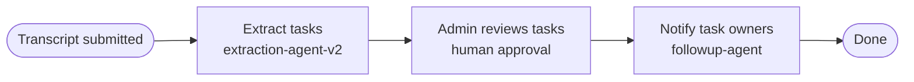
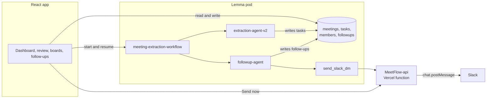

<div align="center">

# MeetFlow

**AI Meeting-to-Execution Operator**

Turn meeting transcripts into approved tasks, live boards, and Slack follow-ups.


[Live app](https://meetflow.apps.lemma.work) · [Demo](#demo) · [How it works](#how-it-works) · [Architecture](#architecture) · [Getting started](#getting-started)

</div>

---

## Demo

<div align="center">

[](https://drive.google.com/file/d/1NTAj0rr46eH1ayhFMRj-ce_rEvBPXvcb/view)

Select the preview to watch the full walkthrough.

</div>

## Overview

Meetings end with commitments that live in someone's notes. Action items go unwritten, owners are unclear, and nobody follows up until a deadline has already slipped.

MeetFlow closes that loop. An admin pastes a transcript and an AI agent extracts each action item with an owner, deadline, and priority. The admin reviews and approves the list, a second agent messages every task owner on Slack, and the team tracks progress on shared Kanban boards.

## How it works



1. **Submit.** An admin pastes a transcript into the New Meeting form. MeetFlow stores the meeting with the status `pending_review` and starts a `meeting-extraction-workflow` run.
2. **Extract.** `extraction-agent-v2` reads the transcript and writes tasks to the `tasks` table, each with an owner, deadline, priority, and context.
3. **Review.** The workflow pauses for a human. The admin edits titles, owners, deadlines, and priorities, then selects **Approve & Notify Team**.
4. **Notify.** Approval resumes the run with `approved: true`. `followup-agent` drafts a personalized message for each task owner and sends it as a Slack direct message. Every message is logged in `followups` as Draft, Pending, Sent, or Failed.
5. **Execute.** Tasks appear on the boards, owners work from **My Tasks**, and admins monitor delivery on the Follow-ups page, where failed messages can be resent.

## Features

- **Transcript to tasks.** Paste a transcript and `extraction-agent-v2` extracts action items, each with an owner, deadline, priority, and a short context note.
- **Human approval gate.** The workflow pauses until an admin edits and approves the extracted tasks. Follow-ups go out only after approval.
- **Slack follow-ups.** `followup-agent` writes a personalized message for each task owner and sends it as a direct message. Each message is logged as Draft, Pending, Sent, or Failed, and failed ones can be resent from the app.
- **Kanban boards.** To do, In progress, Done, and Blocked columns with drag and drop. Switch between per-meeting and workspace-wide views, filter by assignee or meeting, copy a read-only board link, or export to JSON.
- **My Tasks.** Each member gets a personal list or board with Due today, This week, In progress, and Overdue filters.
- **Role-based access.** Admin, Member, and Observer roles control who can create meetings, approve tasks, and move cards.
- **Dashboard.** Meetings this week, tasks extracted, completion rate, and overdue count, plus recent meetings and open tasks.
- **Keyboard shortcuts.** Press Ctrl/Cmd+K or `/` for the command palette, and `N` to start a new meeting as an admin.

## Architecture

MeetFlow's backend runs on [Lemma](https://lemma.work). A Lemma pod holds the data tables, AI agents, workflow, and functions, and the React app talks to it through the Lemma SDK.



| Component | Role |
| --- | --- |
| React app | Single-page app built with Vite. Signs users in with Lemma's `AuthGuard`, reads and writes records through the Lemma SDK, and starts and resumes workflow runs. |
| Lemma pod | Hosts the four tables, the two agents, the extraction workflow, and the `send_slack_dm` function. |
| [MeetFlow-api](https://github.com/Adi-Marathe/MeetFlow-api) | Serverless function that looks up a Slack user by email and posts a direct message with a bot token. Called by the pod's function and by the app's **Send now** button. |

## Tech stack

| Area | Stack |
| --- | --- |
| Frontend | React 19, Vite 8, React Router 7 |
| UI | Framer Motion, dnd-kit, Lucide, React Icons, canvas-confetti |
| Backend | Lemma SDK (`lemma-sdk` 0.5): tables, agents, workflows, functions |
| Auth | Lemma `AuthGuard` |
| Messaging | Slack Web API (`users.lookupByEmail`, `chat.postMessage`) behind a Vercel serverless function |

## Roles

| Role | Access |
| --- | --- |
| Admin | Dashboard, Meetings, review and approval, Follow-ups, Settings, My Tasks, and every board. Can move any card. |
| Member | My Tasks and boards. Can move only the cards they own. |
| Observer | Read-only boards. Every new sign-up starts as an Observer until an admin promotes them in **Settings > Members**. |

## Data model

| Table | Purpose | Key fields |
| --- | --- | --- |
| `meetings` | One row per transcript | `id`, `title`, `date`, `source`, `raw_transcript`, `participants`, `status`, `workflow_uid` |
| `tasks` | Action items extracted from meetings | `id`, `meeting_id`, `title`, `owner`, `deadline`, `priority`, `status`, `context` |
| `members` | People and their roles | `id`, `name`, `email`, `role`, `joined_at` |
| `followups` | Every follow-up message and its delivery state | `id`, `task_id`, `owner_email`, `channel`, `status`, `draft_message`, `summary` |

Status values: meetings move from `pending_review` to `approved`. Tasks use `todo`, `inprogress`, `done`, and `blocked`. Follow-ups use `Draft`, `Pending`, `Sent`, and `Failed`. Member roles are `admin`, `member`, and `observer`.

## Getting started

### Prerequisites

- Node.js 20 or later
- A Lemma account with access to a pod
- A Slack workspace where you can install an app

### 1. Install

```bash
git clone https://github.com/Adi-Marathe/MeetFlow.git
cd MeetFlow
npm install
```

### 2. Set up the Lemma pod

The app expects these resources in your pod. Field details are in [Data model](#data-model).

| Resource | Name |
| --- | --- |
| Tables | `meetings`, `tasks`, `members`, `followups` |
| Agents | `extraction-agent-v2`, `followup-agent` |
| Workflow | `meeting-extraction-workflow`: extract tasks, then a human review step with an `approved` field, then notify task owners |
| Function | `send_slack_dm`, source in [`functions/send_slack_dm`](functions/send_slack_dm). Input: `owner_email` and `message` |

Set your pod ID in `src/lib/lemma.js`. The frontend needs no `.env` file.

```js
const POD_ID = 'your-pod-id'
```

### 3. Deploy the Slack relay

Slack messages are sent by [MeetFlow-api](https://github.com/Adi-Marathe/MeetFlow-api).

1. Create a Slack app, add the bot scopes `chat:write`, `users:read`, and `users:read.email`, and install it to your workspace.
2. Deploy MeetFlow-api to Vercel with the environment variable `SLACK_BOT_TOKEN` set to the bot token.
3. Set `VERCEL_API_URL` in `src/lib/slack.js` to your deployment's `/api/send-dm` URL.

The endpoint accepts a JSON `POST`:

```json
{ "email": "teammate@company.com", "message": "Reminder: the dashboard is due July 3." }
```

It responds with `{ "ok": true, "error": null }` on success, or `{ "ok": false, "error": "..." }` with the reason. Task owners are matched to Slack users by email, so each member's MeetFlow email must match their Slack email.

### 4. Run

```bash
npm run dev       # start the dev server
npm run build     # create a production build
npm run preview   # preview the production build
```

The first time you sign in, you are created as an Observer. To make yourself an admin, set `role` to `admin` on your row in the `members` table.

## Project structure

<details>
<summary>Show the folder layout</summary>

```text
MeetFlow/
├── functions/
│   └── send_slack_dm/          Lemma function that sends a Slack DM
├── public/                     Static assets
├── src/
│   ├── assets/                 Images
│   ├── components/
│   │   ├── features/           Kanban board, transcript forms, command palette, cards
│   │   ├── layout/             Sidebar, page wrapper
│   │   └── ui/                 Button, modal, badge, avatar, toggle, confetti
│   ├── context/                Theme and toast providers
│   ├── hooks/                  useCurrentMember, useKeyboardShortcut
│   ├── lib/                    lemma.js (pod client), slack.js (DM client), helpers
│   ├── mock/                   Sample data
│   ├── pages/                  Landing, Dashboard, Meetings, MeetingReview, BoardView,
│   │                           MyTasks, Followups, Settings
│   ├── App.jsx                 Routes, role guards, Lemma AuthGuard
│   └── main.jsx                Entry point
├── index.html
├── package.json
├── payload.json                Sample input for send_slack_dm
└── vite.config.js
```

</details>

## Roadmap

- WhatsApp, Telegram, and email follow-ups alongside Slack
- Transcript import from Google Meet, Zoom, and Microsoft Teams
- Scheduled reminders for tasks that are due soon or overdue
- Persisted workspace and notification settings, plus member invites
- Pod definitions (tables, agents, workflow) exported into the repo for one-command setup

## Team

Built by [Aditya Marathe](https://github.com/Adi-Marathe) for the Gappy AI Hackathon 2026.
